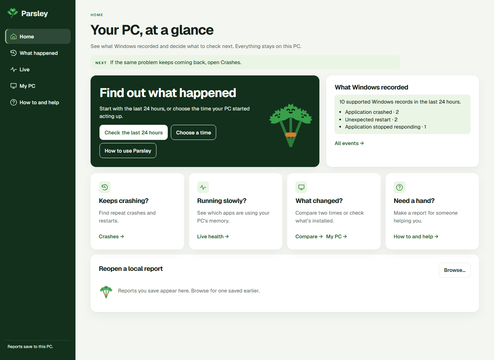

<picture>
  <source media="(prefers-color-scheme: dark)" srcset="docs/cover-dark.svg">
  
</picture>

<p align="center">
  <a href="https://github.com/Primitivelabai/parsley/releases/download/v0.10.0/Parsley-0.10.0-windows-x64.zip"><strong>Download for Windows x64</strong></a> &nbsp;·&nbsp;
  <a href="docs/USAGE.md">Usage guide</a> &nbsp;·&nbsp;
  <a href="#privacy">Privacy</a> &nbsp;·&nbsp;
  <a href="docs/rewind-report.png">Example report</a>
</p>

<p align="center">
  <a href="https://github.com/Primitivelabai/parsley/releases">Releases</a> &nbsp;·&nbsp;
  
  
  <a href="LICENSE"></a>
</p>

Open **What happened → Story** to see what happened around a crash. Follow the timeline back to the original Windows records, or compare it with a time when your PC was working normally.

Under **How to and help**, you can practise with a graphics-driver reset, a crashing application or an unexplained restart.

<picture>
  <source media="(prefers-color-scheme: dark)" srcset="docs/rewind-steps-dark.svg">
  
</picture>

## What it does



- **Investigate.** Rewind to a crash or restart, import an `.evtx` log, bookmark the evidence and compare two sessions.
- **Monitor.** Watch CPU, memory, disk, network and GPU activity where Windows exposes it. Record in the background while signed in, or take a 15-second per-process bandwidth sample.
- **Check what changed.** Compare two device and software inventories.
- **Share.** Build a redacted support report, or export selected events as HTML, CSV or JSON.

## Get started

1. [Download the Windows x64 ZIP](https://github.com/Primitivelabai/parsley/releases/tag/v0.10.0) and extract it.
2. Run `parsley-desktop.exe`.
3. On **Home**, select **Check the last 24 hours** to see what Windows recorded on this PC.
4. In **Story**, select a record to read its details. Use **Save report** to keep a copy and reopen it from Home.

Open **How to and help** for steps and optional practice cases. **Live → Health** shows a current reading from your PC when you open it.

> [!NOTE]
> The current portable preview is unsigned, so Windows may warn you before it opens. The archive also includes `parsley.exe` for the command line, example reports, source and dependency notices. [Read the full usage guide.](docs/USAGE.md)

## Privacy

Parsley processes diagnostics locally and saves reports to files you choose.

- **Off by default.** Real-log HTML timelines leave out application and module names unless you include them.
- **Asks first.** The optional bandwidth capture asks Windows for administrator permission. Everything else uses your existing Windows permissions.
- **Left out.** Bandwidth reports include process identifiers and byte totals, and leave out IP addresses, ports and packet contents.

> [!IMPORTANT]
> Raw Windows records and optional health or inventory snapshots can contain private details. Review a report before you share it.

## Develop

Build on Windows with Rust’s `x86_64-pc-windows-msvc` target. Node.js is used for packaging.

```powershell
cargo test --locked
cargo build --locked --release --bins
node tools/package-windows.mjs OUTPUT_DIR WORK_DIR
```

The desktop uses Windows WebView2. Run `parsley-desktop.exe --classic` for the native interface.

[Contributing](CONTRIBUTING.md) · [CLI and packaging reference](docs/USAGE.md) · [Report a bug](https://github.com/Primitivelabai/parsley/issues/new?template=bug_report.yml)

## Licence

[MIT](LICENSE). Geist and Geist Mono use the [SIL Open Font License](ui/OFL-LICENSE.txt).

<p align="center"></p>
